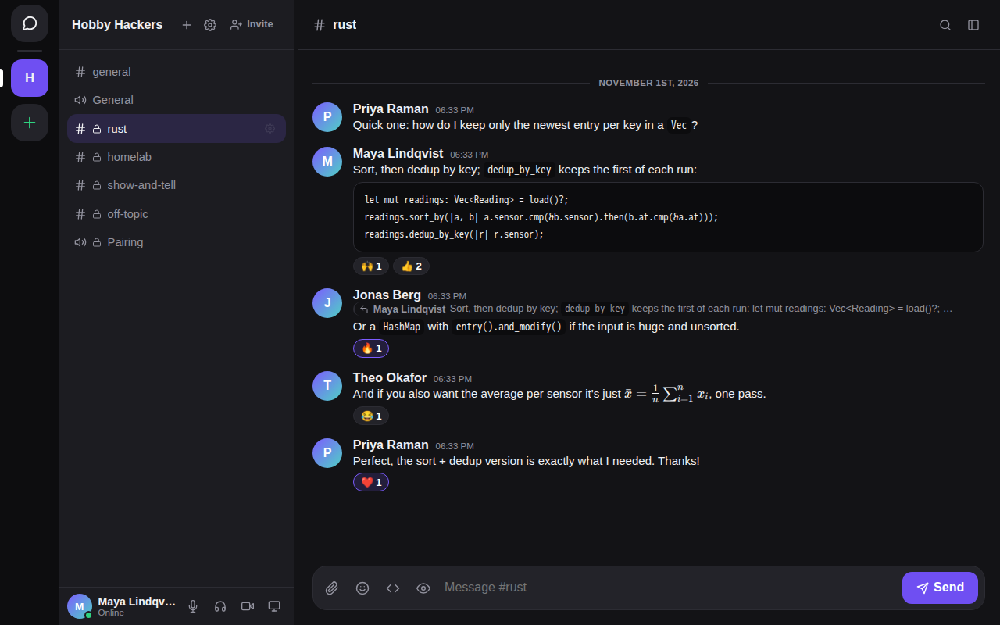
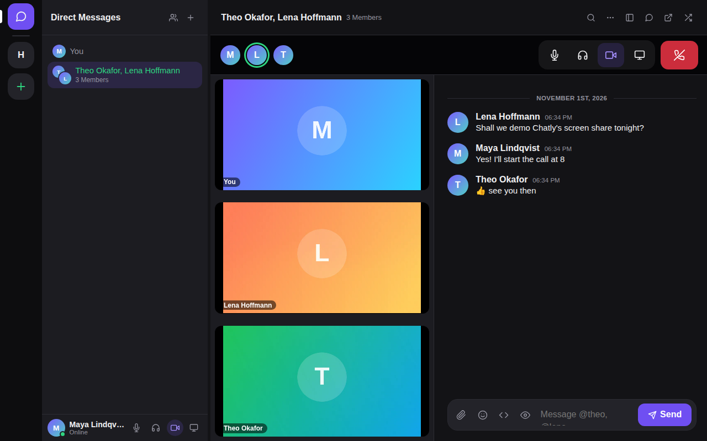
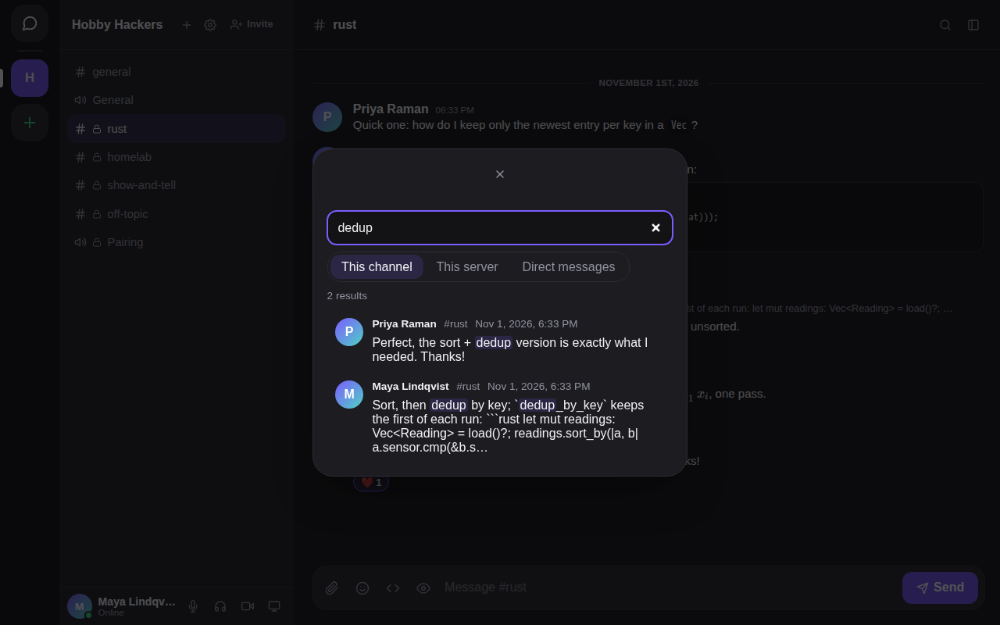
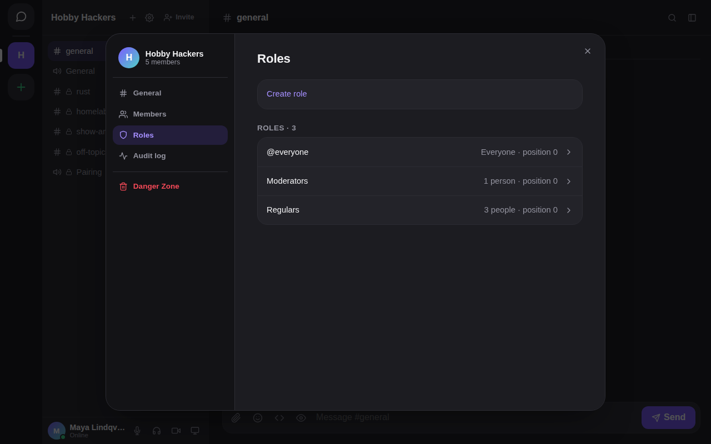
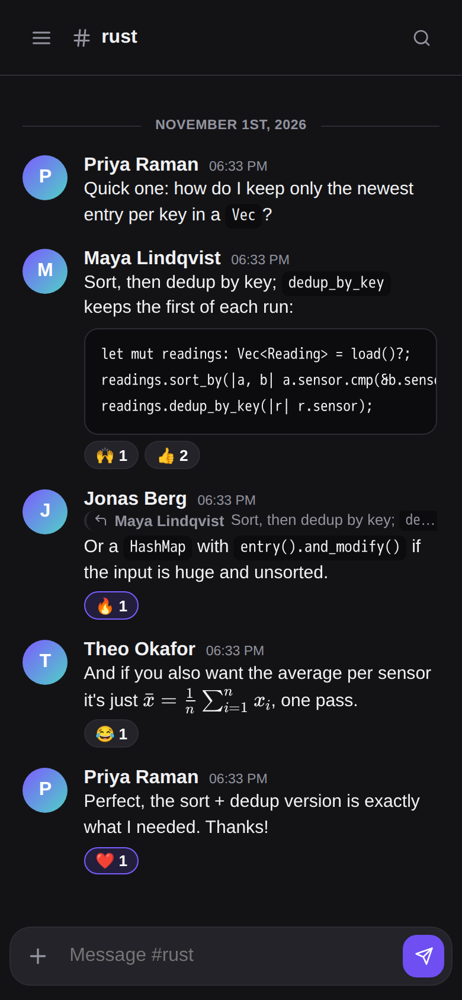
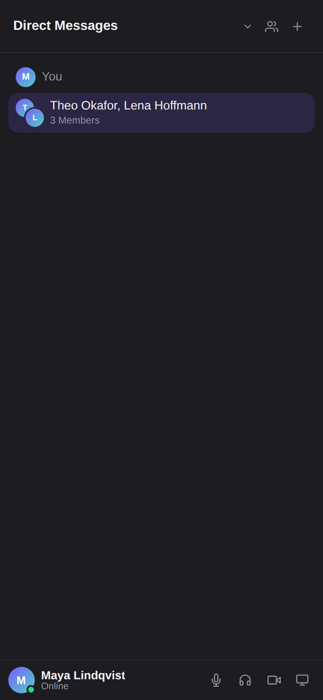

<p align="center">
  
</p>

<h1 align="center">Chatly</h1>

<p align="center">
  Self-hosted chat for a community of 50–100 people: servers, channels, DMs, voice, video and screen sharing.<br/>
  One Rust binary, one SQLite file, no third parties.
</p>

<p align="center">
  <a href="https://github.com/esbeneickhardt/Chatly/actions/workflows/ci.yml"></a>
</p>

<p align="center">
  <a href="#quick-start-docker">Quick start</a> · <a href="docs/admin.md">Self-hosting guide</a> · <a href="docs/architecture.md">Architecture</a> · <a href="docs/api.md">API</a> · <a href="CHANGELOG.md">Changelog</a>
</p>

<div align="center">
<table>
<tr>
  <td align="center"><br/><sub>Channels: Markdown, code, LaTeX, replies, reactions</sub></td>
  <td align="center"><br/><sub>Group calls with video, next to the chat</sub></td>
</tr>
<tr>
  <td align="center"><br/><sub>Full-text search</sub></td>
  <td align="center"><br/><sub>Roles and per-channel permissions</sub></td>
</tr>
</table>
<table>
<tr>
  <td align="center"></td>
  <td align="center"></td>
</tr>
<tr><td colspan="2" align="center"><sub>Installable on phones, with push notifications</sub></td></tr>
</table>
</div>

<sub>Screenshots are from a demo instance with made-up people.</sub>

A Discord-style text + voice server for a self-hosted community. One
binary, one container, one data volume. No third-party identity
providers, no telemetry, no external service required at runtime.

## What it does

- **Servers** (made with *Add Server*) with text and voice channels,
  private channels, roles and per-channel permission overrides, bots, and
  invite links; **server admins** run a server, and a single **global
  admin** runs the whole deployment (all accounts, all servers).
- **Direct messages**: 1:1, groups, friends, pinning, and calls with
  ringing — adding someone to a 1:1 starts a new group and keeps the 1:1.
- **Voice, video and screen sharing** through a built-in relay (SFU) with
  an optional TURN fallback for hard NATs.
- Markdown, LaTeX, replies, reactions, attachments, and message
  export; TOTP two-factor authentication; guest links for a quick call.
- Backup/restore and account-recovery commands (`chatly --help`).

Not included: end-to-end encryption, federation, clustering. See
[docs/admin.md](docs/admin.md#current-limitations).

## Documentation

| | |
|---|---|
| [docs/admin.md](docs/admin.md) | Run it: install, configuration, backups, recovery, reverse proxy |
| [docs/architecture.md](docs/architecture.md) | How it fits together, and the authorization model |
| [docs/api.md](docs/api.md) | Every HTTP route |
| [docs/openapi.json](docs/openapi.json) | The same routes as an OpenAPI 3 file (generated) |
| [docs/protocol.md](docs/protocol.md) | The WebSocket gateway and voice signalling |
| [CONTRIBUTING.md](CONTRIBUTING.md) | Working on it: setup, checks, conventions |
| [SECURITY.md](SECURITY.md) | What it protects, and how to report a problem |
| [CHANGELOG.md](CHANGELOG.md) | What changed |
| [PLAN.md](PLAN.md) | The original roadmap (historical) |

## Quick start (development)

Requires Rust (stable, via [rustup](https://rustup.rs)) and Node 22.12+.

```sh
just web    # build the client into web/dist
just run    # cargo run, serving web/dist from disk
```

Open http://localhost:8080 (if that port's already in use on your
machine, run `LISTEN_ADDR=127.0.0.1:8090 just run` instead).

```sh
just test   # cargo test --workspace
just lint   # cargo fmt --check + clippy -D warnings
```

Web checks live in `web/` (`npm run typecheck`, `lint`, `format:check`,
`test`, and `e2e` for the browser tests); see [CONTRIBUTING.md](CONTRIBUTING.md).

## Quick start (Docker)

```sh
mkdir -p data
docker run --rm -v "$(pwd)/data:/data" busybox chown 65532:65532 /data
cp docker/.env.example docker/.env   # set PUBLIC_URL, VOICE_PUBLIC_IP, TURN_REALM, TURN_SECRET
just up     # docker compose -f docker/docker-compose.yml up -d --build
```

Open http://localhost:8090 — the compose file publishes host port 8090
(not 8080) since 8080 is a very commonly occupied port; see
[docs/admin.md](docs/admin.md) for why the `chown` step is needed, how
to change the port, and for configuration, backups, and upgrades.

## Repository layout

```
crates/
  protocol/   shared wire types (IDs, errors, permissions) — no I/O
  server/     the binary: HTTP API, gateway, voice SFU, storage, CLI
  totp/       self-contained RFC 6238 TOTP implementation
web/          TypeScript client (Vite, no framework)
docker/       Dockerfile and docker-compose.yml
docs/         admin guide, architecture, API and protocol reference
```

## License

AGPL-3.0-or-later.
