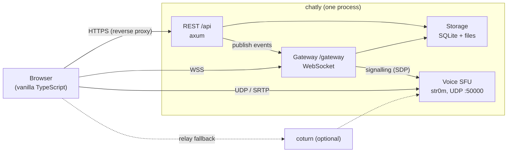
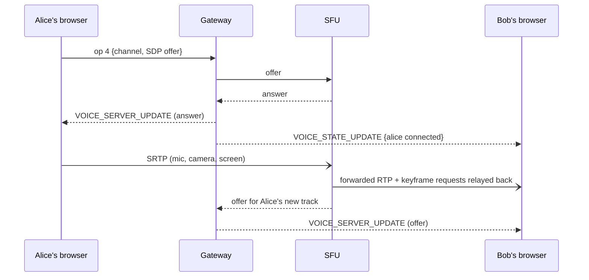

# Architecture

How Chatly fits together, for someone about to change it. For the HTTP
surface see [api.md](api.md); for the WebSocket and voice signalling see
[protocol.md](protocol.md); to run it, [admin.md](admin.md).

## Shape of the system

One Rust binary (`chatly`), one SQLite database, one directory of
uploaded files, one UDP port for calls. The web client is built
separately and **embedded in the binary**, so there is nothing else to
deploy.

The HTTP port is meant to sit behind a reverse proxy that terminates
TLS (compose binds it to `127.0.0.1` only). The voice UDP port is
exposed directly; that is the one deliberate exception.

## Repository layout

| Path | What lives there |
|---|---|
| `crates/protocol` | Types shared by client and server that must never drift: snowflake `Id`, the `Permissions` bitflags and the resolution algorithm, the API error shape |
| `crates/totp` | RFC 6238 TOTP and base32, dependency-free |
| `crates/server` | The application (below) |
| `web/` | The client: Vite + TypeScript, no framework |
| `docker/` | Dockerfile (multi-stage: web build, static musl binary) and compose |
| `docs/` | This documentation |

Inside `crates/server/src`:

| Module | Responsibility |
|---|---|
| `api/` | One file per resource; handlers are thin: parse → authorize (`api/permissions.rs`) → call `Storage` → publish events → respond |
| `auth/` | Argon2 password hashing, session tokens (only hashes are stored), the session cookie, the pre-auth store for the MFA step |
| `gateway/` | The WebSocket: identify/heartbeat, and `GatewayHub`, the in-memory fan-out |
| `voice/` | The SFU: `mod.rs` (the public handle and signalling), `client.rs` (one participant's connection and tracks), `sfu.rs` (the driver loop that forwards media) |
| `storage/` | `Storage` is the union of twelve small traits, one per area (`accounts.rs`, `guilds.rs`, `messages.rs`, …), each file holding the contract *and* its SQLite implementation; `sqlite.rs` is the connection, `queries/` the SQL per table group, `migrations.rs` the runner |
| `ratelimit.rs`, `client_ip.rs`, `csrf.rs`, `security_headers.rs` | Cross-cutting request hardening |

## Request lifecycle

1. `security_headers` adds CSP and friends to every response.
2. Under `/api`, `csrf::require_header` rejects a mutating request with no
   `X-Requested-With`.
3. The `CurrentUser` extractor resolves the session cookie (or a bot
   token) to a user, or fails with 401.
4. The handler checks permission (see below), calls the `Storage` trait,
   and — **only after the transaction commits** — publishes a
   `DispatchEvent` to the `GatewayHub`.
5. Errors are `AppError` values that render as
   `{"error":{"code","message"}}`.

## Storage

SQLite in WAL mode with foreign keys on, through one `rusqlite`
connection behind a mutex, always used on a blocking thread
(`SqliteStorage::with_conn`). That's deliberate: at the target scale
(50–100 people) it's ample, it keeps synchronous calls off the async
workers, and it makes every multi-statement operation trivially atomic.
Handlers only see the `Storage` trait, so the backend is swappable.

Schema changes are numbered SQL files in `crates/server/migrations`,
applied in order at startup and recorded in `schema_version`. Never edit
a released migration; add a new one. A migration that rebuilds a table
other tables reference must manage its own transaction (see the
`MANUAL_TRANSACTION` marker) because `PRAGMA foreign_keys` is ignored
inside one. After any migration a `foreign_key_check` runs and startup
fails loudly rather than serving a corrupt database. **Before shipping a
migration, run it against a copy of a real database** (`chat.db`,
`chat.db-wal`, `chat.db-shm` copied together into a scratch directory).

Uploaded files live under `data/files`; `secret_key` (encrypts TOTP
secrets at rest) lives beside the database. Back up the whole data
directory (see [admin.md](admin.md)).

## The gateway

`GatewayHub` keeps one `tokio::sync::broadcast` channel per **room**.
A room id is one of:

- a **guild id** — everything in that server (messages, presence, voice
  state);
- a **DM channel id** — one conversation;
- a **user id** — that person's private room, for things addressed to one
  account (a friend request, "you were added to a chat").

Ids come from a single snowflake generator, so the three kinds never
collide. A connection subscribes to its user room, every guild it's in,
and every DM it's in; when a `DM_CHANNEL_CREATE` arrives on its user room
it subscribes to the new channel on the fly. There is no resume: a
reconnect gets a fresh `READY`, and the client refetches what it needs.

## Authorization model

There are exactly **two levels of administrator**, kept separate on
purpose:

| | Scope | Who | Can |
|---|---|---|---|
| **Global admin** | the whole deployment | the first account registered (`users.is_owner`); transferable | see and manage every account and every server (`/api/admin/*`), whether or not they've joined it |
| **Server admin** | one server | that server's *owner*, plus anyone with the `ADMINISTRATOR` permission | everything inside that server; only the *owner* can delete or hand over the server or demote another admin |

Being the global admin grants **no standing inside a server you haven't
joined**, and being a server admin grants nothing globally. There are no
per-channel admins: what someone can do in a channel is the server-level
permission set, refined by that channel's overwrites.

Server-level permissions are bitflags (`protocol::permissions`). A
member's effective permissions in a channel resolve in a fixed order —
the owner or an `ADMINISTRATOR` holder short-circuits to everything;
otherwise union of their roles (including `@everyone`), then the
`@everyone` overwrite, then their roles' overwrites, then their own
overwrite. Two guards keep delegation safe: you can only grant a
permission you hold, and only manage a role below your own highest one.

Channels a person isn't on the member list of are invisible to them (404,
not 403), except to server admins. Direct messages have no roles: any
participant can read and write.

## Voice and video

Calls are relayed by an **SFU**, not peer-to-peer, so a call with several
people uploads once. Signalling rides the gateway (op 4 up,
`VOICE_SERVER_UPDATE` down); media is SRTP over the single UDP port.

Key points:

- The SFU never transcodes; it forwards packets and relays keyframe
  requests (PLI/FIR, throttled) to the sender.
- There is no per-DM "ringing" object. A call is just people being in a
  voice channel; clients infer an incoming call from a
  `VOICE_STATE_UPDATE` on a DM they aren't in. When someone is added to a
  DM mid-call the server replays the current participants' joins to that
  one person so they get the same ring.
- Toggling camera or screen share renegotiates the live peer connection in
  place (`web/src/voice/signaling.ts`; the offer is flagged `renegotiate`), so
  the microphone and everyone's audio are not interrupted. Only a connection
  that is down, or that fails to change, is rebuilt. Your voice is sent at
  64 kbps and "high" priority, ahead of video.
- Screen-share video is sent as *motion* content (hold frame rate, shed
  resolution) with explicit bitrate/frame-rate limits, and viewers can
  boost quiet shared audio up to 300% (`web/src/voice.ts`).
- The SFU does not do downstream bandwidth estimation or pacing. See
  "Known limitations" in [admin.md](admin.md).

## The web client

Vanilla TypeScript, built by Vite; there is no UI framework. Views build
DOM imperatively.

| File | Role |
|---|---|
| `main.ts` | Boot, session check, login/registration routing |
| `api.ts` | `fetch` wrapper and the shared response types |
| `gateway.ts` | The WebSocket: heartbeat, reconnect, typed event listeners |
| `voice/` | `VoiceClient`, `signaling.ts` (offer/answer and the camera/screen slots), mic, remote audio |
| `views/chat.ts` | The main screen (see "Decomposing the chat view" below) |
| `views/video-panel/` | The call video grid: one tile per camera or screen share, layouts, pop-outs (`popout.ts`) |
| `command-palette.ts`, `fuzzy.ts`, `views/chat/commands.ts` | The Ctrl/Cmd+K quick switcher |
| `views/dm-call.ts` | Ringing, the incoming-call card, and the DM call "stage" |
| `views/search.ts`, `search-logic.ts` | Message search panel; the pure word/highlight logic |
| `views/*.ts` | Settings, server settings, global admin, audit log, friends, auth |
| `notifications.ts`, `public/sw.js`, `public/manifest.webmanifest` | Background notifications and installability (the service worker deliberately caches nothing) |
| `a11y.ts` | A safety net for accessible names, labels and keyboard access |
| `ui.ts` | Shared building blocks (avatar, confirm dialog) |

Conventions worth keeping: never recreate a live `<video>` element,
re-parent it; use CSS custom properties for JS-driven positioning; keep
per-device preferences in `localStorage`; mobile is the 768 px
breakpoint.

### Small files, by rule

No hand-written source file may exceed **600 lines** — Rust, TypeScript and
CSS alike, tests included. A test (`file_size_tests.rs`) fails the build
otherwise, and its exception list is empty. When a file grows past the
limit, split it by responsibility; don't raise the limit.

How the biggest pieces were divided, so the shape is predictable:

- **`web/src/views/chat.ts`** (was one 5,000-line function) is a ~540-line
  composition root over `views/chat/*`: `sidebar`, `header`, `stage-dom`,
  `composer-dom`, `panes`, `voice-controls` (the parts of the screen and their
  elements); `guild-rail`, `channels`, `direct-messages`, `navigation` (what
  they do); `messages`, `history`, `composer-actions` (messages and
  composing); `people`, `events`, `wiring` (who's known, live events); and
  `state.ts`, the one object holding everything that changes while you use
  the screen. Each `create*(ctx)` says in its `Context` interface exactly
  what it needs from the rest.
- **`views/settings/`, `views/servers/`, `views/guild-settings/`** have one
  file per tab or modal; **`views/video-panel/`** splits into `layout`, `pip`
  and `tiles`; **`voice/`** into the client, `remote-audio`, `local-mic`,
  `screen-capture` and helpers; **`styles/`** is twelve ordered CSS files
  (the import order in `main.ts` *is* the cascade).
- **Server**: the storage layer and the SFU as described above; the HTTP
  tests are one file per area under `http_tests/`.

Two lessons from doing it. Move code with a script and let `tsc`, the
linter and the end-to-end tests referee — a scripted identifier rewrite once
turned the URL `/api/dms/…` inside a string into `/api/ctx.dms/…`, which no
type-checker can see and only the "declining a call" browser test caught.
And prefer one shared state object to threading a dozen `let`s through
callbacks.

## Testing

- **Rust unit tests** sit beside the code (permissions, TOTP, ids,
  migrations, rate limiting).
- **HTTP tests** (`crates/server/src/http_tests.rs`) drive the real
  router over a real temp database through `test_support::TestApp` — no
  socket, but everything else is real (routing, CSRF, cookies,
  permissions, storage). Start here when adding an endpoint.
- **Web unit tests** (`web/src/**/*.test.ts`, Vitest) cover pure logic.
- **End-to-end tests** (`web/e2e/`, Playwright) run two or three real
  browsers against a real server for the flows that matter most
  (calls, DMs, admin levels).
- **CI** runs formatting, clippy, all of the above, and a dependency
  audit on every push.
